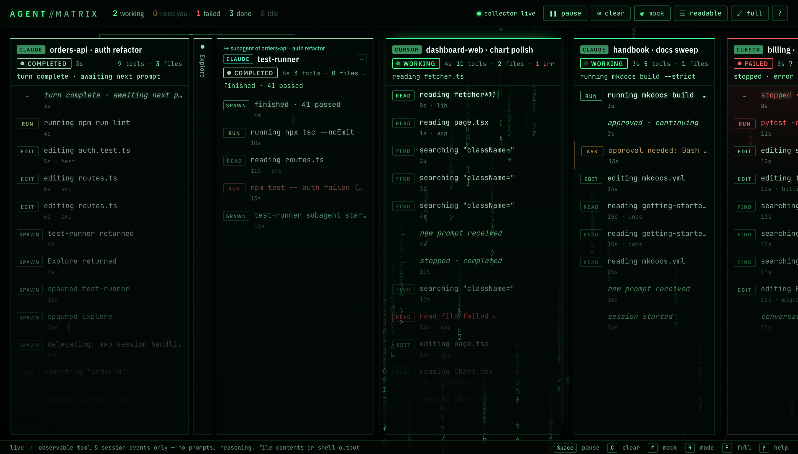

# Agent Matrix

A local-first, full-screen live view of the AI coding agents running on your machine. Each agent gets its own vertical lane. As the agent works, short readable chunks of activity flow down the lane: *reading routes.ts*, *editing auth.ts*, *running npm test*, *needs approval*, *finished*. Behind each lane, the rain *is* the work: every activity drops a vertical column spelling out what happened (`$ npm test`, `+ src/auth.ts`, `/verifyToken/`, `? git push`), written downward Matrix-style with a bright head and a fading trail. There is no filler: an idle lane is still, and a busy lane pours.



It shows **observable events only**: tool calls, touched file paths and status changes, as reported by Claude Code and Cursor hooks. It does not show, store or claim to reveal prompts, model reasoning, file contents or shell output.

---

## Quick start

```bash
npm install
```

```bash
npm run dev
```

Open http://127.0.0.1:5173. Mock agents start streaming straight away, with no setup needed.

`npm run dev` runs two processes:

| process | address | what it does |
| --- | --- | --- |
| UI (Vite + React) | `127.0.0.1:5173` | the matrix; proxies `/api` to the collector |
| collector (Node) | `127.0.0.1:4317` | receives hook events, keeps an in-memory buffer, streams to the UI |

To run a single process that serves the built UI and the collector together:

```bash
npm start
```

Then open http://127.0.0.1:4317.

Requires Node 18.17+ (developed on Node 22).

## Using it

| control | key | |
| --- | --- | --- |
| pause / resume | `Space` | Freezes the flow so you can read. Status and attention keep updating, and a badge counts queued chunks. |
| clear | `C` | Clears every lane and the collector's buffer. |
| mock | `M` | Turns the built-in demo agents on or off. Mock and live lanes can run side by side. |
| readable / atmos | `R` | **Atmos**: activity rain, decode-in text, glow. **Readable**: no rain or glow, larger type, calmer motion. Readable is the default if your OS asks for reduced motion. |
| full screen | `F` | |
| help | `?` | |

The lanes, left to right:

- **Lane header**: provider badge, agent name (workspace plus session, or the subagent type), a state pill with time in state, tool and file counters, and the current activity.
- **States**: `working` (green), `needs you` (amber, pulsing), `failed` (red), `completed` (pale green), `idle` (grey; no events for 90s).
- **Needs you**: when any agent is waiting for approval or input, an amber strip appears under the top bar. It names each agent and what it is waiting for, and clicking an entry scrolls to and flashes that lane. The browser tab title also shows `(N) needs you`.
- **Subagents** sit to the right of their parent, joined by a bracket, and their headers say *↳ subagent of …*. The parent lane gets *spawned X* and *X returned* chunks. Finished subagents collapse into a thin strip after 8s; click the strip, or double-click a header, to toggle it.
- **Activity rain** (atmos mode): each chunk released into a lane also falls as a vertical column of its command, file or pattern. The sigil shows the kind: `$` run, `+` edit, `/…/` search, `>>` spawn, `?` needs approval, `x` failure. Colour matches the chunk: lime for runs, green for edits and reads, teal for spawns, amber for approvals, red for failures. Chunk text sits on dark plates so the columns pass behind the words.
- **Flow control**: each lane releases chunks at a steady pace. When a burst arrives, queued chunks of the same kind merge (*reading 7 files*). A tool's start chunk shows a blinking cursor and is updated in place when the tool completes, so each call takes one line. Failures get their own red line.
- Finished lanes are retired after 15 minutes (35s for mock lanes).

## Architecture

```
Claude Code ──(hook stdin JSON)──┐
                                 ├─▶ hooks/agentviewer-hook.mjs ──HTTP──▶ collector :4317 ──SSE──▶ UI
Cursor ──────(hook stdin JSON)──┘     • allow-list redaction           • provider adapters
                                      • 400ms timeout, always exit 0    • normalise → AgentEvent
                                                                        • 2000-event ring buffer
anything else ──POST /api/events (canonical AgentEvent)──────────────▶  • 200ms re-order window
```

| path | role |
| --- | --- |
| `shared/events.ts` | provider-neutral event format (`AgentEvent`) |
| `hooks/agentviewer-hook.mjs` | the hook command both tools run; zero dependencies |
| `hooks/redact.mjs` | privacy filter, shared by the hook and the collector |
| `server/collector.ts` | HTTP + SSE collector; also serves `dist/` |
| `server/adapters/claude.ts` | Claude Code hook payload → `AgentEvent`s |
| `server/adapters/cursor.ts` | Cursor hook payload → `AgentEvent`s (see the Cursor limitations) |
| `src/store.ts` | lane state, per-lane queue, coalescing, idle detection |
| `src/mock.ts` | demo scenarios |
| `scripts/setup-hooks.mjs` | safe config installer |
| `scripts/simulate-hooks.mjs` | end-to-end test with realistic hook payloads |

### Collector API

| method & path | |
| --- | --- |
| `POST /api/ingest/claude` · `POST /api/ingest/cursor` | hook payloads, as sent by the hook script |
| `POST /api/events` | one canonical `AgentEvent`, or an array of them; invalid items are skipped |
| `GET /api/events?since=<ms>` | buffered events |
| `DELETE /api/events` | clear the buffer |
| `GET /api/stream` | SSE: a `snapshot` event, then `events` batches, then `cleared` |
| `GET /api/health` | counters |

The collector listens on `127.0.0.1` only. It rejects write requests that carry a non-localhost `Origin`, so a web page can't post into it. Bodies are capped at 256 KB, and nothing is written to disk.

### Event format

```ts
interface AgentEvent {
  v: 1;
  id: string;
  ts: number;                    // epoch ms
  provider: string;              // "claude-code" | "cursor" | "mock" | anything
  type: 'session_started' | 'agent_started' | 'agent_status_changed'
      | 'tool_started' | 'tool_completed' | 'file_changed' | 'approval_needed'
      | 'subagent_started' | 'subagent_completed' | 'session_completed' | 'session_failed';
  sessionId: string;             // groups lanes
  agentId: string;               // one lane
  parentAgentId?: string;        // subagents
  label?: string;                // lane name
  status?: 'working' | 'waiting' | 'completed' | 'failed' | 'idle';
  summary: string;               // short, already-sanitised text
  kind?: 'read' | 'search' | 'edit' | 'run' | 'web' | 'delegate' | 'approval' | 'status' | 'other';
  tool?: string;  toolUseId?: string;  files?: string[];  ok?: boolean;  durationMs?: number;  cwd?: string;
}
```

Any other tool can feed the matrix by posting these events:

```bash
curl -X POST localhost:4317/api/events -H 'content-type: application/json' -d '{"type":"tool_started","provider":"my-agent","sessionId":"s1","agentId":"s1","label":"my agent","summary":"reading main.go","kind":"read"}'
```

---

## Connecting Claude Code

Claude Code [command hooks](https://code.claude.com/docs/en/hooks) receive a JSON payload on stdin for each lifecycle event. The setup script registers `hooks/agentviewer-hook.mjs` for these events:

| Claude Code event | becomes |
| --- | --- |
| `SessionStart` | `session_started` |
| `UserPromptSubmit` | `agent_status_changed → working` (*new prompt received*; the prompt text is dropped) |
| `PreToolUse` | `tool_started` (*reading routes.ts*, *running npm test*, …) |
| `PostToolUse` | `tool_completed`, or `file_changed` for Edit / Write / NotebookEdit |
| `PostToolUseFailure` | `tool_completed` with `ok:false` (*npm test · exit code 1*) |
| `PermissionRequest`; `Notification` with `permission_prompt`, `elicitation_dialog`, `agent_needs_input` | `approval_needed` |
| `Notification` with `idle_prompt` | `agent_status_changed → waiting` |
| `SubagentStart` / `SubagentStop` | `subagent_started` / `subagent_completed` (a child lane keyed by `agent_id`) |
| tool events carrying `agent_id` | placed in that subagent's lane |
| `Stop` | `agent_status_changed → completed` (*turn complete · awaiting next prompt*) |
| `StopFailure` | `session_failed` |
| `PreCompact` | *compacting context* |
| `SessionEnd` | `session_completed` |

### Install (backs up and merges; never overwrites)

```bash
npm run setup:claude                  # dry run: shows the merged ~/.claude/settings.json
npm run setup:claude -- --write       # backs up to settings.json.agentviewer-backup-<time>, then merges
```

To install for a single project, the hooks go in that project's `.claude/settings.local.json`, which isn't committed:

```bash
npm run setup:claude -- --project ~/code/my-app --write
```

To print the snippet and paste it in yourself:

```bash
npm run setup:claude -- --print
```

To remove only the Agent Matrix entries:

```bash
npm run setup:claude -- --uninstall --write
```

The installer keeps all your other settings and hooks. It recognises its own entries by `agentviewer-hook.mjs`, so re-running it updates them instead of adding duplicates. It will not touch a settings file that isn't valid JSON.

Each installed entry looks like this:

```json
{ "hooks": { "PreToolUse": [ { "hooks": [ {
  "type": "command",
  "command": "/usr/local/bin/node /path/to/agentviewer/hooks/agentviewer-hook.mjs claude",
  "timeout": 5,
  "async": true
} ] } ] } }
```

- `async: true` runs the hook in the background, so it never delays a tool call. `SessionStart` and `SessionEnd` run synchronously with 3s and 2s timeouts so they're delivered reliably.
- The command uses the absolute path to the `node` binary that ran the installer. If you switch Node versions, for example with nvm, re-run the installer.
- Start a new Claude Code session afterwards. `/hooks` inside Claude Code lists the hooks that are active.

## Connecting Cursor

```bash
npm run setup:cursor                                   # dry run for ~/.cursor/hooks.json
npm run setup:cursor -- --write                        # back up + merge
npm run setup:cursor -- --project ~/code/my-app --write  # writes <project>/.cursor/hooks.json
npm run setup:cursor -- --print
```

Restart Cursor afterwards.

### Cursor limitations

- **The Cursor schema is unverified.** Cursor's official hooks page (`cursor.com/docs/agent/hooks`) could not be reached from the environment this prototype was built in, so the adapter wasn't checked against the current docs. It follows Cursor's hooks design as published in late 2025:
  - `hooks.json` with `"version": 1`
  - the events `beforeSubmitPrompt`, `before/afterShellExecution`, `before/afterMCPExecution`, `beforeReadFile`, `afterFileEdit` and `stop`
  - the common fields `conversation_id`, `generation_id`, `hook_event_name` and `workspace_roots`

  The adapter ignores unknown events and accepts alternative field spellings. Before relying on it, compare `server/adapters/cursor.ts` with the current docs.
- **Only observational hooks are installed by default**: `beforeSubmitPrompt`, `afterShellExecution`, `afterMCPExecution`, `afterFileEdit` and `stop`. The `before*` execution and read hooks expect a permission decision, and this tool never makes one. Since the behaviour of an empty reply isn't confirmed, those hooks are opt-in with `--cursor-extended`. That flag also adds `sessionStart`, `sessionEnd`, `subagentStart`, `subagentStop`, `postToolUse` and `postToolUseFailure`, if your Cursor version has them.
- With the defaults, Cursor lanes show prompts, edits, finished shell commands, MCP calls and stops. File reads and subagents appear only with the extended set.
- `afterAgentResponse` / `afterAgentThought` carry model text and are deliberately ignored.
- The hook replies `{"continue":true}` to `beforeSubmitPrompt` and `{}` to everything else. It never blocks a prompt or a command.

## Fail-open behaviour

The hook script is the only part that runs inside your agent's process tree, and it is built so it can't get in the way:

- It always exits `0`, including when the collector is down, the input is malformed, or the script itself crashes.
- The POST to the collector times out after 400ms, and a watchdog exits the process after about 1.1s whatever happens. Typical run time is about 50ms.
- It prints nothing for Claude Code; some Claude Code events add hook stdout to the model's context. For Cursor it prints only the neutral replies above.
- To switch it off without uninstalling, set `AGENTVIEWER_DISABLE=1` in the agent's environment.

To check this yourself, stop the collector and keep working. Nothing changes in the agent.

## Privacy

Redaction happens in `hooks/redact.mjs` **before the payload leaves the hook process**, and runs again in the collector. It works from an allow-list:

- **Kept**: event names, session and agent ids, the working directory, tool names, file paths (shown relative to the workspace), the first line of shell commands, search patterns (truncated), URL hosts, short subagent descriptions, exit codes and durations.
- **Dropped**: prompts, assistant messages, tool output and responses, file contents, edit diffs, transcripts, MCP results and stack traces.
- **Scrubbed** in the strings that are kept: `NAME_TOKEN=…`-style assignments, `--password`/`--token` flags, `Authorization`/`Bearer` values, `user:pass@` in URLs, and common token shapes (`sk-…`, `ghp_…`, `xox…-`, `AKIA…`, JWTs, long hex strings). Everything becomes `•••`.

`npm run simulate` sends payloads containing planted prompts, file contents and secrets through the real pipeline and checks that none of them reach the collector's buffer.

## Configuration

| env var | default | |
| --- | --- | --- |
| `AGENTVIEWER_PORT` | `4317` | collector port; used by the collector, the Vite proxy and the hook |
| `AGENTVIEWER_URL` | `http://127.0.0.1:$PORT` | where the hook sends events |
| `AGENTVIEWER_HOOK_TIMEOUT_MS` | `400` | hook POST timeout |
| `AGENTVIEWER_DISABLE` | unset | `1` makes the hook a no-op |
| `AGENTVIEWER_HOST` | `127.0.0.1` | collector bind address (prints a warning if it isn't loopback) |
| `AGENTVIEWER_QUIET` | unset | `1` stops the collector logging each event |

## Troubleshooting

- **The header says "collector offline".** Start the collector with `npm run dev` or `npm start`. Mock mode works without it.
- **No live lanes appear.**
  1. Run `npm run simulate` with the collector running. If the simulated sessions appear, the collector and UI are fine and the problem is the hook registration.
  2. Check the hook command by hand:

     ```bash
     echo '{"hook_event_name":"SessionStart","session_id":"t","cwd":"/tmp"}' | node hooks/agentviewer-hook.mjs claude
     ```

     A *session started* lane should appear.
  3. In Claude Code, run `/hooks` to confirm the entries are there, and start a new session.
  4. For Cursor, restart Cursor and check its hooks output or log for errors.
- **"hook error" notices, or `node: not found`.** The installer writes an absolute path to `node`. If that Node install has moved, re-run `npm run setup:claude -- --write`.
- **Port 4317 is already in use.** Set `AGENTVIEWER_PORT` for both the collector and the agent's environment, then re-run setup. The port is read when the hook runs, so the variable has to be set where the agent runs.
- **The lanes are too busy or too fast.** Press `Space` to pause, or `R` for readable mode, which also slows the release rate.
- **Old sessions are cluttering the screen.** Press `C`. Finished lanes also retire on their own after 15 minutes.

## Development

```bash
npm test             # redaction, both adapters, collector HTTP, hook fail-open
```

```bash
npm run typecheck
```

```bash
npm run simulate     # realistic Claude Code + Cursor payloads through the real hook script
```

## Known limitations

- Everything is held in memory (2000 events), so restarting the collector clears the history.
- Async Claude Code hooks can arrive slightly out of order. The collector re-orders within a 200ms window by the time each hook started, and drops a `PreToolUse` that arrives after its `PostToolUse`.
- Claude Code reports the end of a turn (`Stop`), not the end of a task, so a lane reads *completed · awaiting next prompt* between prompts.
- A Claude Code lane is named after the workspace folder plus a short session id, or the session title when the hook payload includes one.
